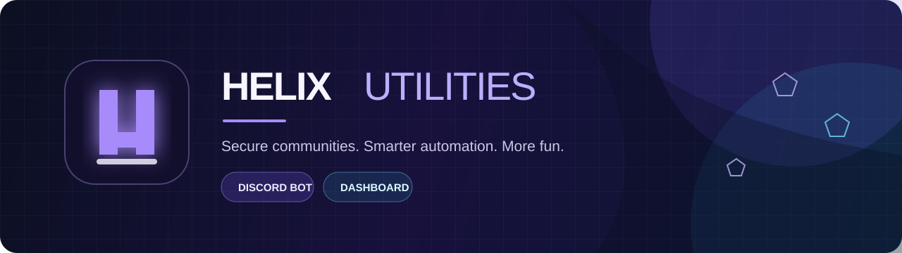

<p align="center">
  
</p>

<p align="center">
  <a href="#quick-start"></a>
  <a href="#features"></a>
  <a href="#deployment"></a>
</p>

<p align="center">
  <strong>An all-in-one Discord bot and dashboard for communities that want security, structure, and a little more fun.</strong>
  <br />
  Antinuke protection · Moderation · Tickets · Leveling · Games · Live server controls
</p>

<p align="center">
  
  
  
  
</p>

<p align="center">
  <a href="#features">Features</a> ·
  <a href="#quick-start">Quick start</a> ·
  <a href="#deployment">Deployment</a> ·
  <a href="#configuration">Configuration</a> ·
  <a href="CONTRIBUTING.md">Contributing</a>
</p>

---

## ✦ Built for better-run servers

<table>
  <tr>
    <td width="50%" valign="top">
      <h3>🛡️ Keep control</h3>
      <p>Antinuke event limits, rollback actions, trusted-user allowlists, automod filters, lockdown snapshots, verification, and detailed moderation logs.</p>
    </td>
    <td width="50%" valign="top">
      <h3>⚙️ Run everything in one place</h3>
      <p>Moderation tools, tickets, reaction roles, giveaways, join-to-create voice channels, invite tracking, welcome flows, and more.</p>
    </td>
  </tr>
  <tr>
    <td width="50%" valign="top">
      <h3>✨ Give members a reason to stay</h3>
      <p>XP and role rewards, birthdays, economy, AFK, autoresponders, boosters, counting, and 16 interactive mini-games.</p>
    </td>
    <td width="50%" valign="top">
      <h3>🌐 Configure without the command maze</h3>
      <p>A Discord OAuth dashboard gives authorized server managers live stats and safe, per-server settings controls.</p>
    </td>
  </tr>
</table>

## Features

| Area | What you get |
| --- | --- |
| **Security** | Antinuke limits for bans, kicks, channels, roles, webhooks, emojis, bot additions, permission grants, vanity changes, and more. |
| **Automod** | Spam, caps, links, invites, mentions, emoji spam, blocked words, role/channel exceptions, and configurable actions. |
| **Moderation** | Ban, softban, kick, mute, warn, purge, slowmode, lock, jail, nick, role, and server-wide lockdown controls. |
| **Management** | Tickets, transcripts, verification, reaction roles, giveaways, welcome messages, autoroles, logs, invites, and join-to-create voice. |
| **Engagement** | XP, ranks, leaderboards, birthdays, AFK, boosters, vanity roles, autoresponders, counting, economy, and mini-games. |
| **Dashboard** | Discord login, server picker, owner-only antinuke controls, module settings, branding, and live stats. |

<details>
<summary><strong>All 16 games</strong></summary>
<br />

Chess · Battleship · Tic-tac-toe · Connect 4 · Wordle · 2048 · Minesweeper · Snake · Memory · Rock-paper-scissors · Hangman · Trivia · Guess · Fast type · Coin flip · Dice
</details>

## Project map

```text
helix-utilities/
├── bot/                     # discord.js bot + authenticated stats API
│   ├── src/commands/        # 52 slash commands
│   ├── src/events/          # Discord event listeners
│   ├── src/modules/         # automod, antinuke, tickets, levels, etc.
│   └── docker-compose.yml   # bot + optional Cloudflare Tunnel
├── dashboard/               # Next.js web dashboard
│   ├── app/                 # pages and API routes
│   └── lib/                 # Discord OAuth, MongoDB, setting validation
├── assets/                  # README artwork
└── CONTRIBUTING.md
```

## Quick start

### 1 — Create a Discord application

1. Create an application in the [Discord Developer Portal](https://discord.com/developers/applications).
2. In **Bot**, reset and copy your bot token. Enable **Server Members Intent**, **Presence Intent**, and **Message Content Intent**.
3. In **OAuth2**, copy the client ID and client secret.
4. Add this redirect URL, replacing it with your dashboard address:

   ```text
   https://YOUR-DASHBOARD.vercel.app/api/auth/callback
   ```

5. Invite the bot to your server. During testing, make sure its role sits above the roles it needs to manage.

### 2 — Create a MongoDB database

Create a MongoDB Atlas cluster, add a database user, and copy its connection string. Both the bot and dashboard use the **same** database.

### 3 — Run the bot

```bash
cd bot
cp .env.example .env
# Fill in DISCORD_TOKEN, CLIENT_ID, MONGODB_URI, and API_KEY.
npm ci
npm run check
npm run deploy
npm start
```

> Set `DEV_GUILD_ID` in `bot/.env` while building. Slash commands appear in that test server immediately; global Discord commands can take a few minutes to update.

### 4 — Run the dashboard locally

```bash
cd dashboard
cp .env.example .env.local
# Fill in every variable in .env.local.
npm ci
npm run dev
```

For local development, use `PUBLIC_URL=http://localhost:3000` and add this exact redirect URL to your Discord application:

```text
http://localhost:3000/api/auth/callback
```

## Configuration

### Bot environment — `bot/.env`

| Variable | Purpose |
| --- | --- |
| `DISCORD_TOKEN` | Bot token from Discord. Keep it secret. |
| `CLIENT_ID` | Discord application ID. |
| `DEV_GUILD_ID` | Optional test server for instant command updates. |
| `OWNER_IDS` | Comma-separated bot-owner user IDs for owner-only commands. |
| `MONGODB_URI` | MongoDB Atlas connection URI. |
| `API_KEY` | Long random key used by the dashboard to authenticate to the bot API. |
| `DASHBOARD_URL` | Public dashboard URL used in bot links. |

### Dashboard environment — `dashboard/.env.local` or Vercel variables

| Variable | Purpose |
| --- | --- |
| `DISCORD_CLIENT_ID` / `DISCORD_CLIENT_SECRET` | OAuth credentials for the Discord application. |
| `DISCORD_BOT_TOKEN` | Server-side bot token for loading channels and roles. |
| `PUBLIC_URL` | Dashboard URL without a trailing slash. |
| `SESSION_SECRET` | A unique random secret; use 32+ characters. |
| `MONGODB_URI` | The same MongoDB URI as the bot. |
| `BOT_API_URL` / `BOT_API_KEY` | The bot stats API URL and matching `API_KEY`. |

> **Never** put real tokens in GitHub. The supplied `.env.example` files are safe templates only.

## Deployment

### Dashboard → Vercel

1. Import this GitHub repository in Vercel.
2. Set **Root Directory** to `dashboard`.
3. Add all values from `dashboard/.env.example` to Vercel’s environment variables.
4. Set `PUBLIC_URL` to your deployed Vercel URL.
5. Update the Discord OAuth redirect URL to `PUBLIC_URL/api/auth/callback`.

### Bot → Docker

```bash
cd bot
cp .env.example .env
# Configure .env first.
docker compose up -d
```

To expose the bot’s authenticated stats API through a permanent HTTPS URL, create a Cloudflare Tunnel, add its token to `CLOUDFLARE_TUNNEL_TOKEN`, and run:

```bash
docker compose --profile tunnel up -d
```

Set your tunnel’s public hostname to forward to `http://bot:3001`, then use that HTTPS URL as `BOT_API_URL` in Vercel.

## Quality checks

Run these before deployment or a pull request:

```bash
cd bot && npm ci && npm run check
cd ../dashboard && npm ci && npm run build
```

## Security notes

- Antinuke configuration is restricted to the Discord server owner.
- Dashboard writes are allow-listed and validated server-side.
- OAuth session cookies are encrypted; production cookies are HTTPS-only.
- The bot stats API requires `x-api-key`, except for the deliberately public `/health` and `/public` endpoints.
- Grant the bot only the permissions your server actually needs; avoid Administrator in production where possible.

## Contributing

Ideas, bug reports, and focused pull requests are welcome. Please read [CONTRIBUTING.md](CONTRIBUTING.md) first.

---

<p align="center">
  Built for communities that want their server to feel <strong>safe, smooth, and alive.</strong>
  <br /><br />
  <sub>Helix Utilities · Discord bot + dashboard</sub>
</p>
